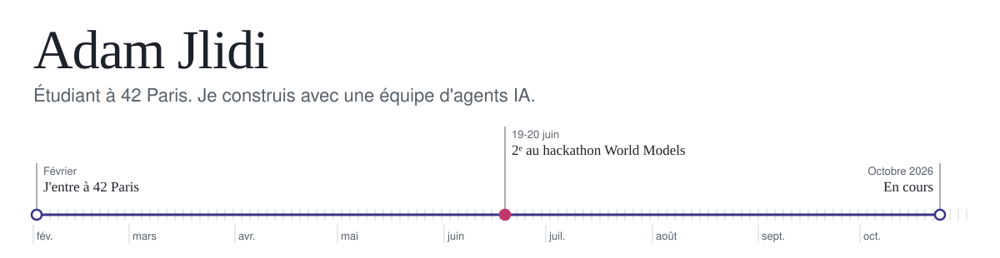

<picture>
  <source media="(prefers-color-scheme: dark)" srcset="assets/banner-dark.svg">
  
</picture>

Avant février 2026, je n'avais jamais écrit une ligne de code : j'ai fait trois ans de licence de biologie. Depuis, j'apprends à [42 Paris](https://42.fr), et je construis surtout avec des agents. Plusieurs sessions Claude Code et Codex travaillent en parallèle, branchées sur des serveurs MCP. Un agent relit le travail d'un autre avant chaque fusion, et rien ne part en build tant que la boucle de tests n'est pas verte.

### Projets

- **Projet privé** : un réseau social sur iOS, Android et web, que je cofonde. Le code est privé.
- **[jepa-fly](https://hacktheworlds.fr)** : 2ᵉ sur 25 équipes au hackathon World Models parrainé par Yann LeCun. Un modèle du monde JEPA entraîné sur l'activité simulée du cerveau de la drosophile.
- **[NeuroTrack](https://github.com/adamlepelletier923-gif/Projet-hackathon-D4GEN-TUMOUR)** : au hackathon D4Gen de Genopole, suivre une tumeur cérébrale d'une IRM à l'autre, jusqu'au verdict de réponse au traitement.
- **[SmartDeploy](https://github.com/adamlepelletier923-gif/smartdeploy)** : un déploiement Kubernetes surveillé par Prometheus, qui revient en arrière tout seul quand la version se dégrade.
- **42 Paris** : [Libft](https://github.com/adamlepelletier923-gif/LIBFT), [get_next_line](https://github.com/adamlepelletier923-gif/Get_next_line_), [push_swap](https://github.com/adamlepelletier923-gif/Push_swap), [Born2beroot](https://github.com/adamlepelletier923-gif/Born2BeRoot) et des [exercices de Python](https://github.com/adamlepelletier923-gif/Python-learning).
- **Révisions** : [Vigie](https://adamlepelletier923-gif.github.io/vigie/), [Psyché](https://adamlepelletier923-gif.github.io/psyche/) et [Hygée](https://adamlepelletier923-gif.github.io/hygee/), trois applis façon Duolingo pour réviser un master de santé publique.

### Outils

**IA et agents** 

**Code** 

**Infra** 

### Liens

Mon [portfolio](https://adamlepelletier923-gif.github.io/portfolio/) et mon [LinkedIn](https://www.linkedin.com/in/adam-jlidi-1a9504296).
